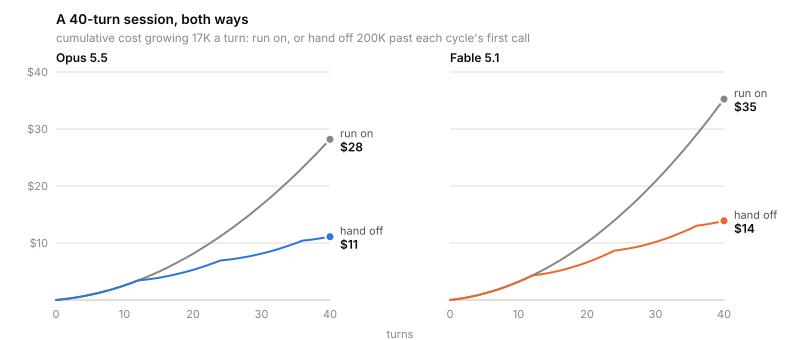

# claude-handoff

**A Claude Code plugin that carries one task across many sessions.**

Each session ends in a handoff written to `.handoff/<slug>/`, and the next session reads it back and resumes where the last one stopped. The plugin tells the session when to hand off, `hq` keeps the thread's record intact from cycle to cycle, and `hq loop` runs the cycle unattended.

```
/handoff write auth-refresh    session 1 writes the thread, then is killed
/handoff read auth-refresh     session 2 picks it up and works the plan
...
hq loop auth-refresh           or let the loop type both, cycle after cycle
```

## Install

```
/plugin marketplace add bissli/claude-handoff
/plugin install claude-handoff@claude-handoff
```

The first command registers the repo as a plugin marketplace. The second installs the hooks, the `/handoff` and `/hq-loop` skills, and the `hq` command. The plugin needs `python3` 3.11 or later on `PATH`. The [status line](#status-line) and the [terminal commands](#terminal-commands) each take one manual step.

## Threads

A thread is one task and its folder at the project root:

```
.handoff/auth-refresh/
  HANDOFF.md      the cursor: task, next step, plan, state, open questions
  ledger.tsv      append-only record of the thread's artifacts
  standing.md     append-only decisions, constraints, dead ends, evidence
  cycles/         each finished HANDOFF.md verbatim
  specs/ drafts/ notes/ outputs/   what the thread made, by kind
```

Each session in a thread is one cycle. The session reads the cursor, works the plan, and near the handoff point writes the cursor again and exits. Decisions and evidence go into `standing.md` and stay there, so a thread twenty cycles old still knows why it chose what it chose.

| Command                 | Action                                       |
| ----------------------- | -------------------------------------------- |
| `/handoff`              | write or read, decided by content            |
| `/handoff <slug>`       | the same, against `.handoff/<slug>/`         |
| `/handoff write [slug]` | write, skipping the decision                 |
| `/handoff read [slug]`  | read one back and resume its plan            |
| `/handoff list`         | every open handoff in the repo, newest first |
| `/handoff check [slug]` | review one handoff in place and fix it       |
| `/handoff done <slug>`  | end the thread; `--undo` reopens it          |
| `/handoff --check`      | write with the reviewer pass                 |

`/handoff` with no verb writes when the session holds anything a fresh session needs that the repo does not hold, and reads when it has only looked something up. Where the verb or the target is ambiguous, it lists the candidates and stops. A check, or a write called with `--check`, ends with a reviewer pass: a fresh agent reads the file cold and reports what a resuming session could not act on. After a write, the session is killed and a fresh one runs the printed `resume:` line.

`hq`, which the plugin puts on the agent's `PATH`, writes the ledger and the standing items, renders the generated blocks of `HANDOFF.md`, and refuses the edits that lose work across cycles. `hq help` lists its reference topics, and `hq <verb> --help` each verb's flags. `.handoff/` goes in the project's `.gitignore` where handoffs stay untracked.

## Unattended runs

`hq run <slug>` starts `claude "/handoff <slug>"` at the project root.

`hq loop <slug>` runs a thread over many cycles with no one typing. Inside a tmux pane it starts claude and opens a driver pane below it. The driver types `/handoff read <slug>`, and when the context notice asks for a write it types `/handoff write <slug>`, then `/clear`, then the read again.

- **Bounds.** `--max-cycles` (default 10) ends the run. A write still unfinished after two retries parks the loop, 500 subagent tool calls in one cycle ring, and a thread with a measure probe holds after four cycles without progress.
- **Parks.** A session with nothing left to do parks the loop. A question, an open dialog, an API error or a hold rings the terminal bell. Any prompt starts the next turn.
- **Permissions.** The loop's hook denies a permission dialog and tells the session why, up to three a session, so no dialog waits for someone to answer it. The allow list still decides what runs unasked.
- **Questions.** The session asks the user only before a step that weakens security or stability. It decides every other question itself and files the decision at the next handoff.
- **Peers.** Threads send each other requests through `.handoff/<slug>/.inbox/`, and a thread parked on a hold or a wait wakes at one.

The loop needs bash 4 or later, `tmux` and `jq`. The `/hq-loop` skill sets a thread up for the loop, adds the optional measure probe, and diagnoses a loop that stalls. [Unattended runs](docs/loop.md) holds the full rules.

## Handoff point

Claude Code re-sends the whole conversation on every API call, so each turn costs more than the one before it and a session's cost climbs as the square of its length. A handoff restarts the climb from a small context.

<picture>
  <source media="(prefers-color-scheme: dark)" srcset="docs/session-cost-dark.svg">
  
</picture>

The handoff point sits at F + W: F is the billed context of the cycle's first call, and W is the work budget, 200,000 tokens unless `HQ_WORK_BUDGET` names another count. Every cycle gets the same room for work, however large its resume. The point never sits closer than one handoff write to the context where Claude Code compacts on its own. [Design](docs/design.md) covers the cost model, the rule, and the detection rules.

The Stop hook prints each of these once, as the session crosses the line:

> Context 275K, at the 269K handoff point for this cycle - a good point to run /handoff.

> Context 302K, 33K past the 269K handoff point, where a handoff begun there would have finished. Every further turn raises the cost of each call of work. Run /handoff.

The second also sends a desktop notification through the terminal.

## Status line

A plugin cannot set the status line, so this block goes into `~/.claude/settings.json` by hand:

```json
{
  "statusLine": {
    "type": "command",
    "command": "python3 \"$(ls ~/.claude/plugins/cache/*/claude-handoff/*/scripts/statusline.py | sort -V | tail -1)\""
  }
}
```

```
218K/269K  Opus 5.5 myproject
275K/269K handoff now  Opus 5.5 myproject:auth-refresh
302K/269K  Opus 5.5 myproject:auth-refresh
```

The line shows the context against the handoff point. It reads both thresholds from the file the Stop hook writes each turn, so the gauge and the warning agree. It turns amber at the point and red one handoff write past it, and shows no gauge before the session's first Stop. Once the session enters a thread, the slug follows the project name. The glob follows the installed copy across upgrades. For a git clone, the command names `/path/to/clone/scripts/statusline.py` instead.

## Terminal commands

The plugin puts `hq` on the agent's `PATH` alone, so a shell reaches `hq run` and `hq loop` through a function in `~/.bashrc`. The function runs the `hq` on `PATH` where there is one, so an agent session keeps the plugin's own, and the newest installed version otherwise. `bin/hq-completion.bash` completes the verb, then the open slugs in the current repo:

```bash
unalias hq 2>/dev/null
hq() {
    local bin
    bin=$(type -P hq) || bin=$(ls -d ~/.claude/plugins/cache/claude-handoff/claude-handoff/*/bin/hq | sort -V | tail -1)
    "$bin" "$@"
}
source "$(ls -d ~/.claude/plugins/cache/claude-handoff/claude-handoff/*/bin/hq-completion.bash | sort -V | tail -1)"
```

`HQ_CLAUDE_CMD` replaces `claude` as the command both verbs start ([Driver](docs/loop.md#driver)).

## Hooks

| Event              | Script              | Effect                                                                             |
| ------------------ | ------------------- | ---------------------------------------------------------------------------------- |
| `Stop`             | `context_budget.py` | warns at the handoff point and once more one handoff write past it                 |
| `Stop`             | `handoff_stop.py`   | names a `HANDOFF.md` written by hand since its last finished cycle                 |
| `PreToolUse`       | `handoff_gate.py`   | after `hq open`, names each gated handoff file a write has not read                |
| `UserPromptSubmit` | `handoff_nudge.py`  | while `~/.claude/.nudge-handoff` exists, asks the agent to hand off past the point |

By default none blocks a tool call. `HQ_GATE=0` turns the gate off, and `HQ_GATE_DENY=1` makes it deny the write instead of reporting it.

The Stop hook's warning reaches the terminal and never the agent. The nudge puts the same fact in front of the agent at the top of each turn past the handoff point, and asks for a handoff at the next natural stopping point when work remains for a later session. Presence of the file is the switch, and it takes effect at the next prompt:

```
touch ~/.claude/.nudge-handoff    # arm
rm -f ~/.claude/.nudge-handoff    # disarm
```

## Update

```
/plugin marketplace update claude-handoff
```

A session open during the update loses `hq` until `/reload-plugins`. Handoff folders are plain Markdown and tab-separated text and need no migration.

## Uninstall

```
/plugin uninstall claude-handoff@claude-handoff
/plugin marketplace remove claude-handoff
```

Three things outlive it: the `statusLine` block in `settings.json`, the state under `~/.claude/cache/claude-handoff/`, and `~/.claude/.nudge-handoff` where it was created. Handoff folders under `.handoff/` belong to the project.

## Development

```
poetry run pytest -q -n auto
poetry run mutmut run
python3 docs/charts.py
```

mutmut mutates the `bin/handoff/` package, through its `src/handoff` symlink, and the two handoff hooks against the tests `pyproject.toml` selects. Per-session state lives under `~/.claude/cache/claude-handoff/`: `<session>.json` for the gauge, `<session>.handoff.json` for the gate and Stop hooks, `<session>.thread` for the status line, and `hq-reads-<session>.txt` for read receipts. All of it is disposable. `docs/charts.py` regenerates the charts in this README and in `docs/design.md`.

## License

MIT
