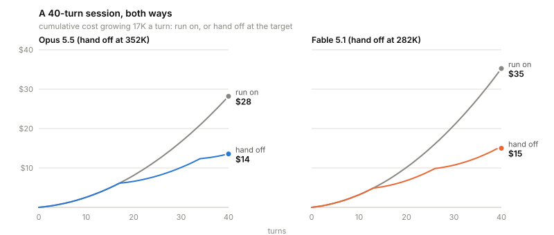

# claude-handoff

**A Claude Code plugin that says, in session and while there is still room, when a conversation has grown expensive enough to hand off, and ships the `/handoff` skill that hands it off.**

Claude Code re-sends the whole conversation on every API call, so each turn costs more than the one before it. At the end of each turn the plugin reads the session transcript, prices the cycle, and warns at the context where handing off costs less than carrying on. `/handoff` writes the session's state to `.handoff/<slug>/`, and a fresh session reads it back and resumes.

```
218K/256K [========--] handoff in 2  ~$0.38/t opus-5-5 myproject
262K/256K [==========] handoff now  ~$0.46/t opus-5-5 myproject
310K/256K  1.2x over  ~$0.55/t opus-5-5 myproject
```

## The problem

<picture>
  <source media="(prefers-color-scheme: dark)" srcset="docs/resend-dark.svg">
  
</picture>

Each turn adds about 17K tokens and re-sends everything before it.

Prompt caching makes the re-read cheap: a cached token costs a twentieth of a fresh one on Opus 5.5 and a fortieth on Fable 5.1. It does nothing about the count of tokens re-read, which grows every turn. The cost of a turn climbs in a straight line, so the cost of a session climbs as its square.

<picture>
  <source media="(prefers-color-scheme: dark)" srcset="docs/session-cost-dark.svg">
  
</picture>

Forty turns growing 17K a turn. Running on costs $28 on Opus 5.5 and $35 on Fable 5.1. Handing off at the target holds it to $14 and $15.

## Install

```
/plugin marketplace add bissli/claude-handoff
/plugin install claude-handoff@claude-handoff
```

The first command registers the repo as a plugin marketplace. The second installs the hooks, the `/handoff` skill, and the `hq` command. The plugin needs `python3` 3.11 or later on `PATH`. The status line takes one manual step ([Status line](#status-line)), and so does `hq run` from a terminal ([Terminal launch](#terminal-launch)).

## Usage

The Stop hook prints each of these once, as the session crosses the line:

> Context 283K, at the 277K handoff point for this cycle, growing 20K a turn - a good point to run /handoff.

> Context 310K, 33K past the 277K handoff point, where a handoff begun there would have finished. Every further turn raises the cost of each call of work. Run /handoff.

The second also sends a desktop notification through the terminal.

`/handoff` with no verb decides between write and read by content. A session holding anything a fresh session needs that the repo does not hold writes. A session that has only looked something up reads. Where the verb or the target is ambiguous, it lists the candidates and stops.

| Command                 | Action                                       |
| ----------------------- | -------------------------------------------- |
| `/handoff`              | write or read, decided by content            |
| `/handoff <slug>`       | the same, against `.handoff/<slug>/`         |
| `/handoff write [slug]` | write, skipping the decision                 |
| `/handoff read [slug]`  | read one back and resume its plan            |
| `/handoff list`         | every open handoff in the repo, newest first |
| `/handoff check [slug]` | review one handoff in place and fix it       |
| `/handoff done <slug>`  | end the thread; `--undo` reopens it          |
| `/handoff --no-check`   | write without the reviewer pass              |

A write ends with a reviewer pass: a fresh agent reads the file cold and reports what a resuming session could not act on. Only the user's `--no-check` skips it. After the write, the session is killed and a fresh one runs the printed `resume:` line.

A thread's folder, `.handoff/<slug>/`, holds:

```
HANDOFF.md      the cursor: task, next step, plan, state, open questions
ledger.tsv      append-only record of the thread's artifacts
standing.md     append-only decisions, constraints, dead ends, evidence
cycles/         each finished HANDOFF.md verbatim
specs/ drafts/ notes/ outputs/   what the thread made, by kind
```

`hq`, which the plugin puts on the agent's `PATH`, writes the ledger and the standing items, renders the generated blocks of `HANDOFF.md`, and refuses the edits that lose work across cycles. `hq help` lists its reference topics, and `hq <verb> --help` each verb's flags. `.handoff/` goes in the project's `.gitignore` where handoffs stay untracked.

### Terminal launch

`hq run <slug>` starts `claude "/handoff <slug>"` at the project root. The plugin puts `hq` on the agent's `PATH` alone, so a shell reaches it through a function in `~/.bashrc`. The function runs the `hq` on `PATH` where there is one, so an agent session keeps the plugin's own, and the newest installed version otherwise. `bin/hq-completion.bash` gives Tab completion of the verb, then of the open slugs in the current repo:

```bash
unalias hq 2>/dev/null
hq() {
    local bin
    bin=$(type -P hq) || bin=$(ls -d ~/.claude/plugins/cache/claude-handoff/claude-handoff/*/bin/hq | sort -V | tail -1)
    "$bin" "$@"
}
source "$(ls -d ~/.claude/plugins/cache/claude-handoff/claude-handoff/*/bin/hq-completion.bash | sort -V | tail -1)"
```

`HQ_CLAUDE_CMD` replaces `claude` as the command `hq run` starts, split as a shell splits it, with `/handoff <slug>` as the last argument. A shell function named `claude` is out of reach of a child process, so a wrapper defined that way takes `HQ_CLAUDE_CMD="bash -ic 'claude \"\$@\"' bash"`, which reads `~/.bashrc` on each run.

### The handoff point

The warning sits at the context where a cycle's cost per call of work is lowest, priced from the session's own transcript: the fresh-session floor, the resume it read, the measured growth rate, and the cache TTL. Running on re-reads a growing context on every call. Handing off pays the resume and the write again. A longer resume, faster growth, or a dearer cache write moves the point out, and the dollar price of a model never moves it. The point never sits closer than one handoff write to the context where Claude Code compacts on its own. `scripts/budget.py` holds the formula and the price table. The hook says nothing on a Haiku session. [Design](docs/design.md) covers the cost model, the formula, the detection rules, and the nudge.

## Status line

A plugin cannot set the status line, so this block goes into `~/.claude/settings.json` by hand:

```json
{
  "statusLine": {
    "type": "command",
    "command": "python3 \"$(ls ~/.claude/plugins/cache/*/claude-handoff/*/scripts/statusline.py | sort -V | tail -1)\""
  }
}
```

The glob follows the installed copy across upgrades, and `sort -V` picks the newest version. For a git clone, the command names `/path/to/clone/scripts/statusline.py` instead. The line reads the growth rate and both thresholds from the file the Stop hook writes each turn, so the gauge and the warning agree. It turns amber at the handoff point and red one handoff write past it. Once the session enters a handoff thread, the thread's slug follows the directory: `myproject:login-timeout`.

## Hooks

| Event              | Script              | Effect                                                                             |
| ------------------ | ------------------- | ---------------------------------------------------------------------------------- |
| `Stop`             | `context_budget.py` | warns at the handoff point and once more one handoff write past it                 |
| `Stop`             | `handoff_stop.py`   | names a `HANDOFF.md` written by hand since its last finished cycle                 |
| `PreToolUse`       | `handoff_gate.py`   | after `hq open`, names each gated handoff file a write has not read                |
| `UserPromptSubmit` | `handoff_nudge.py`  | while `~/.claude/.nudge-handoff` exists, asks the agent to hand off past the point |

By default none blocks a tool call. `HQ_GATE=0` turns the gate off, and `HQ_GATE_DENY=1` makes it deny the write instead of reporting it.

The Stop hook's warning reaches the terminal and never the agent. The nudge puts the same fact in front of the agent at the top of each turn past the handoff point, and asks for a handoff at the next natural stopping point when work remains for a later session. Presence of the file is the switch, and it takes effect at the next prompt:

```
touch ~/.claude/.nudge-handoff    # arm
rm -f ~/.claude/.nudge-handoff    # disarm
```

## Update

```
/plugin marketplace update claude-handoff
```

A session open during the update loses `hq` until `/reload-plugins`. Handoff folders are plain Markdown and tab-separated text and need no migration.

## Uninstall

```
/plugin uninstall claude-handoff@claude-handoff
/plugin marketplace remove claude-handoff
```

Three things outlive it: the `statusLine` block in `settings.json`, the state under `~/.claude/cache/claude-handoff/`, and `~/.claude/.nudge-handoff` where it was created. Handoff folders under `.handoff/` belong to the project.

## Development

```
python3 -m pytest -q
poetry run mutmut run
python3 docs/charts.py
```

mutmut mutates `bin/hq.py` and the two handoff hooks against the tests `pyproject.toml` selects. Per-session state lives under `~/.claude/cache/claude-handoff/`: `<session>.json` for the gauge, `<session>.handoff.json` for the gate and Stop hooks, `<session>.thread` for the status line, and `hq-reads-<session>.txt` for read receipts. All of it is disposable. `docs/charts.py` regenerates the charts in this README and in `docs/design.md`.

## License

MIT
