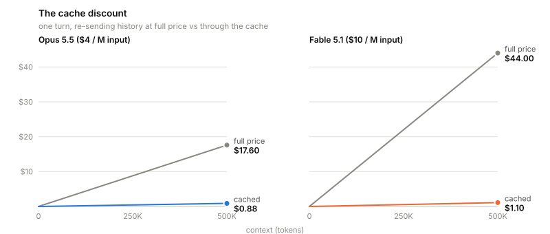
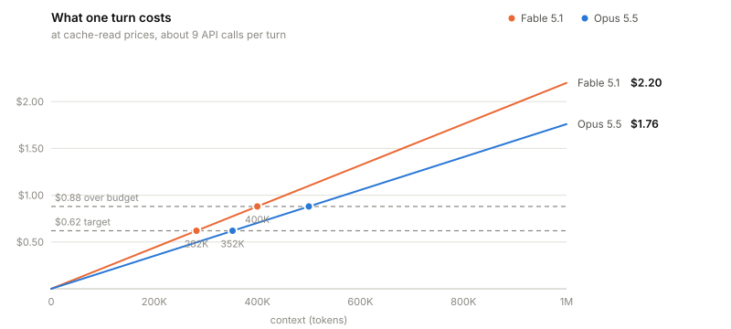

# Design

The cost case behind the warning, the arithmetic of the handoff point, and the rules the hooks read a transcript by. `scripts/budget.py` holds the prices, the defaults, and the formula. `scripts/context_budget.py` holds the detection rules. `scripts/handoff_nudge.py` holds the nudge.

## Cost model

A turn is one prompt plus everything Claude does before it waits again, about 9 API calls, one per tool call. Every call re-sends the whole conversation. One turn costs:

```
one turn = context x cache-read price x calls per turn
         = context / 1M x cache-read $/M x 8.8
```

Prompt caching is what makes this affordable. A cached token costs a twentieth of a fresh one on Opus 5.5 and a fortieth on Fable 5.1.

<picture>
  <source media="(prefers-color-scheme: dark)" srcset="cache-discount-dark.svg">
  
</picture>

The cache lowers the price of each re-read token. It does nothing about the count of tokens re-read, which grows every turn.

<picture>
  <source media="(prefers-color-scheme: dark)" srcset="cost-per-turn-dark.svg">
  
</picture>

One turn at cache-read prices, and what the same turn costs without the cache:

| context | Opus 5.5 | without cache | Fable 5.1 | without cache |
| ------- | --------: | -------------: | ---------: | -------------: |
| 100K    | $0.18    | $3.52         | $0.22     | $8.80         |
| 200K    | $0.35    | $7.04         | $0.44     | $17.60        |
| 500K    | $0.88    | $17.60        | $1.10     | $44.00        |
| 1M      | $1.76    | $35.20        | $2.20     | $88.00        |

Per-turn cost climbs in a straight line, so a session's total climbs as its square: each turn costs more than the one before it. A handoff resets the line. The session below starts at the 69K floor, grows 17K a turn, and restarts at 72K after each handoff. A handoff write spends about two of the forty turns, so the held column also buys a little less finished work.

| 40 turns on | hand off at target | run on | held vs run on |
| ----------- | ------------------: | ------: | --------------: |
| Opus 5.5    | $14                | $28    | -52%           |
| Fable 5.1   | $15                | $35    | -57%           |

The cache and the handoff cut different halves of the bill. On the Fable 5.1 run-on session, the cache turns a would-be $1,410 into $35. The handoff turns the $35 into $15.

## Handoff point

The warning sits at the context where a cycle's cost per call of work is lowest. A cycle runs from a session's first call, or from the first call after a restart in place, to the handoff that ends it. Carrying on re-reads a growing context on every call. Handing off pays a cycle's fixed overhead again: the resume, the write, the cache writes of the floor, and the output the resume and the write bill.

Costs are counted in read-token units. Every call bills its whole context at the cache-read price. A token written to the cache bills m - 1 more, on top of the read its own call already counts. An output token bills r.

```
F   billed context of the cycle's first call
Fw  tokens that first call writes to the cache
C0  billed context at the resume end, call j0
S0  billed context summed over the resume's calls up to and including j0
Or  output tokens the resume's calls before j0 bill, thinking included
g   tokens added per call of work, measured from j0 on
w   calls a handoff write takes: 2 turns x 8.8 = 17.6
W   tokens a handoff write adds: 29,000
Ow  output tokens a handoff write bills: 20,000
m   cache-write price / cache-read price
r   output price / cache-read price

A  = S0 + w x (C0 + W/2) + (m - 1) x (Fw + C0 - F + W) + r x (Or + Ow)
H* = min(C0 + sqrt(2 x g x A), 967,000 - W)
```

A is what a cycle pays whatever its length. T calls of work re-read `g x T^2 / 2` tokens on top of C0, so one call of work costs `K + g x T / 2 + A / T`, where K does not depend on T. That is lowest at `T = sqrt(2 x A / g)`, where the context reaches H*. At H* the next call of work costs as much as a call of work averages over a fresh cycle, so A is the next cycle's overhead, and the current cycle's measurements stand in for it. The dollar price cancels. Only the ratios m and r remain.

W and Ow are fixed. A handoff write prints the handoff rules and writes one document, and neither grows with the work before it.

The cap lets a write begun at H* finish before 967,000 tokens, where Claude Code compacts a session on its own: the 1M window every priced model has, less a 20,000-token output reserve and a 13,000-token buffer.

### Sensitivities

| Change                          | Effect on H*                                                           |
| ------------------------------- | ---------------------------------------------------------------------- |
| a longer resume (larger C0, S0) | out, and the room past it, H* - C0, grows too                          |
| faster growth (larger g)        | out in tokens: A does not depend on g, so the room grows as sqrt(g)    |
| a dearer cache write or output  | out, through m and r; the 1-hour TTL writes at 1.6x the 5-minute price |
| the dollar price of the model   | none                                                                   |

A fixed warning point would take every resume token out of the work room, so each handoff's larger resume would shorten the next cycle.

### The m and r ratios

m and r come from the model and the cache TTL. A cache write costs 1.25 times the base input price at the 5-minute TTL and 2 times at the 1-hour TTL, on every model. The TTL is the one that carried more of the cycle's cache writes in each call's `usage.cache_creation` breakdown. A cycle with no breakdown prices at the 1-hour TTL, the one Claude Code writes at.

| tier                          | cache read  | m, 5-minute | m, 1-hour | r   |
| ----------------------------- | ----------- | -----------: | ---------: | ---: |
| Opus 5.5                      | 0.05x input | 25          | 40        | 100 |
| Fable 5.1                     | 0.025x      | 50          | 80        | 200 |
| any other Opus, Fable, Sonnet | 0.1x        | 12.5        | 20        | 50  |

Worked values on Opus 5.5 at the 1-hour TTL, with F 62,000, Fw 50,000, g 2,300, and Or 3,000, so m is 40 and r is 100:

| C0      | S0        | A          | H*      |
| ------- | --------- | ---------- | ------- |
| 80,000  | 700,000   | 8,446,200  | 277,110 |
| 150,000 | 1,060,000 | 12,768,200 | 392,350 |
| 200,000 | 1,300,000 | 15,838,200 | 469,918 |

### Bands and latching

Band 0 is the handoff point. Band 1 sits W past it, where a handoff begun at band 0 would have finished, and raises a desktop notification through the terminal. Each band is announced once, on entry. Before band 0 is announced, the point follows the measured rate both ways, so the fallback rate of a cycle's first calls cannot pin it low. Once band 0 is announced, both points latch: either may fall, and neither rises, because context only grows and a point that moved outward would walk the gauge backwards. A restart in place rearms the bands and releases both latches.

### The resume boundary

The resume starts at the cycle's first `hq open`, with `--root` or `--session` allowed ahead of the verb. It runs through every following call whose tool uses are all one of:

- a `Read` of any path, a `Skill` call, or a `ToolSearch` call
- a Bash command naming `.handoff` or `HANDOFF`, running an hq read verb (`open`, `read`, `standing`, `artifacts`, `when`, `arc`, `list`, `help`), or running one of the two drift checks `hq open` prints (`git log <sha>..HEAD`, `git status --porcelain`)

A call with no tool use reads back too: it is the agent's recap or reply. j0 is the first call after those: the first to use any other tool, or the first to answer a prompt a person typed after the open. A person's prompt is a user record whose origin kind is `human`. A headless transcript records no origin, so there the resume ends on tool uses alone.

j0 is the first call of work. Its context closes the resume, so C0 and S0 count it, and its output is work, so Or stops at the call before it. A cycle still reading its handoff back has j0 at its last call, which Or counts. A cycle with no `hq open` has j0 at its first call, so C0 and S0 are both F and Or is 0.

A session that works first and opens a handoff later starts its resume at the run of read-back calls that ends at the open, reaching back at most to the call that answers the last prompt before it, whatever that call's tools. The growth of the work before that run comes out of C0 and out of every call of S0, so the resume is priced from the floor, as the next cycle will pay it.

## Prices and defaults

The prices the plugin prices against, per million tokens:

| tier      | input  | cache read | 5-minute write | 1-hour write | output |
| --------- | ------: | ----------: | --------------: | ------------: | ------: |
| Opus 5.5  | $4.00  | $0.20      | $5.00          | $8.00        | $20.00 |
| Fable 5.1 | $10.00 | $0.25      | $12.50         | $20.00       | $50.00 |
| Sonnet 5  | $2.00  | $0.20      | $2.50          | $4.00        | $10.00 |

A cache read is a multiple of the input price, and the multiple differs by model: 0.05 on Opus 5.5, 0.025 on Fable 5.1, and 0.1 on Sonnet 5 and every earlier tier. The plugin stores each model's own input, cache-read, and output prices, so a model matched to its family in place of its own generation would be priced at up to four times what it bills. The tier keys match as substrings of the model id, most specific first. Haiku has no entry, so the hook and the status line say nothing on a Haiku session.

| default                                             | value                           |
| --------------------------------------------------- | -------------------------------: |
| assistant calls per user turn                       | 8.8                             |
| growth per call until a cycle measures its own rate | 1,900 tokens (about 17K a turn) |
| calls of work a cycle needs to measure its rate     | 5                               |
| billed context of a fresh session                   | 69,000                          |
| billed context after a restart in place             | 123,000                         |
| turns a handoff write takes                         | 2                               |
| context a handoff write adds                        | 29,000                          |
| output a handoff write bills                        | 20,000                          |
| context where Claude Code compacts                  | 967,000                         |

Sessions with different tool habits grow at different rates, which is why the hook re-measures growth per session.

## Detection rules

- Growth is measured from the billed-context series itself. A headless transcript does not mark which records a person typed, and a turn's call count varies widely. The series has neither problem. The rate is the mean over the last 60 calls of work, from j0 on. That leaves out the drop at a restart in place, which would read as negative growth, and the resume's own reading, which grows the context far faster than work does and which C0 already counts.
- Billed context is `cache_read + cache_creation + uncached_input` on the last call.
- A restart in place is a drop of more than half of what a session restarts at, 61,500 tokens. A smaller dip, such as an expired cache block or a tool result leaving the window, keeps the growth measurement.
- A failed API call is written to the transcript with a zeroed usage block. It is skipped. Read as a context of zero it would look like a restart in place, and the run after it would count the whole conversation as growth since zero.
- Sidechain records are skipped. They carry a subagent's context.
- A subagent's own Stop is skipped. Its context is short-lived and never restarts in place, so a warning there gives the user nothing to act on.
- Claude Code writes one API response as several records sharing a message id. The first record's counts stand for the call, and its tool uses are gathered from every record.

## Nudge

The Stop hook's warning reaches the terminal and never the agent. While `~/.claude/.nudge-handoff` exists, a `UserPromptSubmit` hook names the context and the handoff point to the agent at the top of each turn past the point.

- The message asks for a handoff at the next natural stopping point, and only when work remains for a later session. The top of a turn is the one moment an instruction redirects a turn without interrupting work under way.
- Presence alone is the switch, read at each prompt. The hook never writes the file and ignores its contents.
- The hook measures the context from the transcript on each prompt. `/clear` keeps the session id and leaves the Stop hook's stored context behind it, so a remembered figure would ask a conversation holding nothing to hand off. The handoff point itself is latched per session and comes from the stored state.
- It stays silent below the handoff point, and inside an open cycle: a `.hq.lock` under two hours old in the nearest handoff root means the agent is already doing what the message would ask. An unreadable lock counts as live, as `hq begin` treats it.
- It keeps no state. Being past the point is a standing condition, so the message repeats every turn it holds.

## Glossary

| term             | meaning                                                                                                         |
| ---------------- | --------------------------------------------------------------------------------------------------------------- |
| turn             | one prompt plus everything Claude does before waiting again                                                     |
| call             | one API request; each tool use is one, about 9 per turn                                                         |
| billed context   | `cache_read + cache_creation + uncached_input` on the last call                                                 |
| cycle            | a session's calls from its first, or from a restart in place, to the handoff that ends it                       |
| resume           | a cycle's calls from `hq open` through its last handoff read; ends at j0                                        |
| floor            | what a session is billed before any conversation: 69K fresh, 123K after a restart in place                      |
| handoff point    | H*, the context where a cycle's cost per call of work is lowest; the gauge's 100% and band 0                    |
| escalation       | band 1, one handoff write past the handoff point                                                                |
| restart in place | a drop in billed context inside one session, such as `/clear`, that rearms the bands and the growth measurement |
