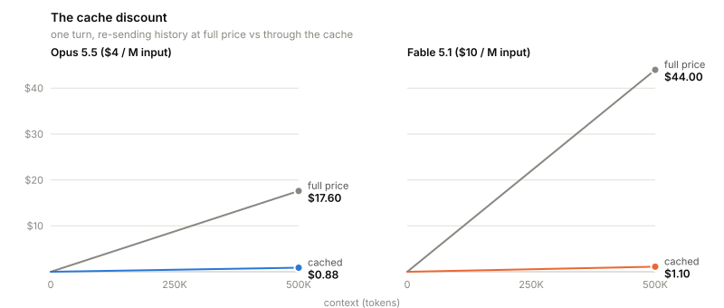
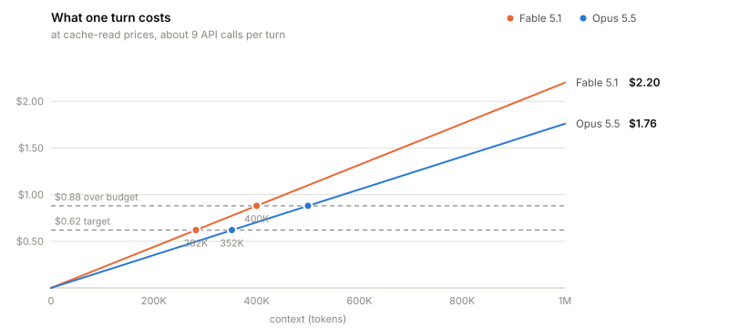

# Design

The cost case behind the warning, the rule that places the handoff point, and the rules the hooks read a transcript by. `scripts/budget.py` holds the defaults and the rule. `scripts/context_budget.py` holds the detection rules. `scripts/handoff_nudge.py` holds the nudge.

## Cost model

A turn is one prompt plus everything Claude does before it waits again, about 9 API calls, one per tool call. Every call re-sends the whole conversation. One turn costs:

```
one turn = context x cache-read price x calls per turn
         = context / 1M x cache-read $/M x 8.8
```

<picture>
  <source media="(prefers-color-scheme: dark)" srcset="resend-dark.svg">
  
</picture>

Prompt caching is what makes this affordable. A cached token costs a twentieth of a fresh one on Opus 5.5 and a fortieth on Fable 5.1.

<picture>
  <source media="(prefers-color-scheme: dark)" srcset="cache-discount-dark.svg">
  
</picture>

The cache lowers the price of each re-read token. It does nothing about the count of tokens re-read, which grows every turn.

<picture>
  <source media="(prefers-color-scheme: dark)" srcset="cost-per-turn-dark.svg">
  
</picture>

One turn at cache-read prices, and what the same turn costs without the cache:

| context | Opus 5.5 | without cache | Fable 5.1 | without cache |
| ------- | --------: | -------------: | ---------: | -------------: |
| 100K    | $0.18    | $3.52         | $0.22     | $8.80         |
| 200K    | $0.35    | $7.04         | $0.44     | $17.60        |
| 500K    | $0.88    | $17.60        | $1.10     | $44.00        |
| 1M      | $1.76    | $35.20        | $2.20     | $88.00        |

Per-turn cost climbs in a straight line, so a session's total climbs as its square: each turn costs more than the one before it. A handoff resets the line. The session below hands off 200K past each cycle's first call, starts at the 69K floor, grows 17K a turn, and restarts at 72K after each handoff. A handoff write spends about two of the forty turns, so the held column also buys a little less finished work.

| 40 turns on | hand off at F + W | run on | held vs run on |
| ----------- | -----------------: | ------: | --------------: |
| Opus 5.5    | $11               | $28    | -61%           |
| Fable 5.1   | $14               | $35    | -61%           |

The cache and the handoff cut different halves of the bill. On the Fable 5.1 run-on session, the cache turns a would-be $1,410 into $35. The handoff turns the $35 into $14.

## Handoff point

A cycle runs from a session's first call, or from the first call after a restart in place, to the handoff that ends it. The warning sits a fixed work budget W past F, the billed context of the cycle's first call:

```
F   billed context of the cycle's first call
W   work budget: 200,000 tokens, or HQ_WORK_BUDGET
Ww  context a handoff write adds: 29,000

H = min(F + W, 967,000 - Ww)
```

Each cycle gets the same room for work whatever its floor and its resume cost. A fixed absolute ceiling is ruled out: the floor rises as a thread ages, so the room under a fixed ceiling shrinks every cycle, and a late thread hands off after a few calls of work. The rule needs no price table and no growth measurement, and any agent that reports its first-call and current context can apply it.

`HQ_WORK_BUDGET` sets W in tokens. A value that is not a positive whole number makes the Stop hook exit with a `ValueError` each turn and store no band, so no warning reaches the terminal and `hq loop` types no handoff until the value is fixed.

The cap lets a write begun at H finish before 967,000 tokens, where Claude Code compacts a session on its own: a 1M window less a 20,000-token output reserve and a 13,000-token buffer. On a smaller window Claude Code compacts before the cap.

### Bands

Band 0 is the handoff point. Band 1 sits Ww past it, where a handoff begun at band 0 would have finished, and raises a desktop notification through the terminal. Each band is announced once, on entry. A restart in place rearms the bands.

## Defaults

| default                                 | value   |
| --------------------------------------- | -------: |
| work budget W                           | 200,000 |
| context a handoff write adds            | 29,000  |
| billed context after a restart in place | 123,000 |
| context where Claude Code compacts      | 967,000 |

## Detection rules

- Billed context is `cache_read + cache_creation + uncached_input` on the last call.
- A restart in place is a drop of more than half of what a session restarts at, 61,500 tokens. The first call after the last such drop is the cycle's F. A smaller dip, such as an expired cache block or a tool result leaving the window, stays inside the cycle.
- A failed API call is written to the transcript with a zeroed usage block. It is skipped. Read as a context of zero it would look like a restart in place.
- Sidechain records are skipped. They carry a subagent's context.
- A subagent's own Stop is skipped. Its context is short-lived and never restarts in place, so a warning there gives the user nothing to act on.

## Nudge

The Stop hook's warning reaches the terminal and never the agent. While `~/.claude/.nudge-handoff` exists, a `UserPromptSubmit` hook names the context and the handoff point to the agent at the top of each turn past the point.

- The message asks for a handoff at the next natural stopping point, and only when work remains for a later session. The top of a turn is the one moment an instruction redirects a turn without interrupting work under way.
- Presence alone is the switch, read at each prompt. The hook never writes the file and ignores its contents.
- The hook measures the context from the transcript on each prompt. `/clear` keeps the session id and leaves the Stop hook's stored context behind it, so a remembered figure would ask a conversation holding nothing to hand off. The handoff point holds for the whole cycle and comes from the stored state.
- It stays silent below the handoff point, and inside an open cycle: a `.hq.lock` under two hours old in the nearest handoff root means the agent is already doing what the message would ask. An unreadable lock counts as live, as `hq begin` treats it.
- It keeps no state. Being past the point is a standing condition, so the message repeats every turn it holds.

## Glossary

| term             | meaning                                                                                   |
| ---------------- | ----------------------------------------------------------------------------------------- |
| turn             | one prompt plus everything Claude does before waiting again                               |
| call             | one API request; each tool use is one, about 9 per turn                                   |
| billed context   | `cache_read + cache_creation + uncached_input` on the last call                           |
| cycle            | a session's calls from its first, or from a restart in place, to the handoff that ends it |
| floor            | F, the billed context of a cycle's first call                                             |
| handoff point    | F + W, capped one handoff write short of compaction; the gauge's denominator and band 0   |
| escalation       | band 1, one handoff write past the handoff point                                          |
| restart in place | a drop in billed context inside one session, such as `/clear`, that rearms the bands      |
